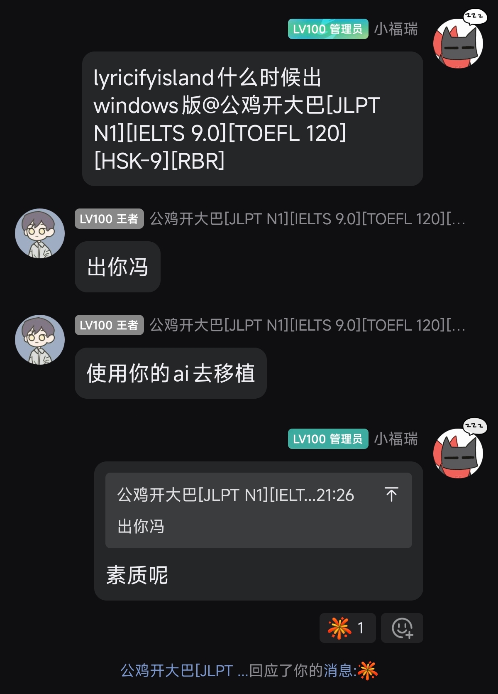

# Kashishu

**原项目由 AI 编写，由大肥鱼完成 Windows/macOS 平台适配**

## 适配理由



https://github.com/user-attachments/assets/bc65054e-03d4-4007-9032-1123cf56aa45

Windows / macOS / Linux 桌面歌词岛。当前曲目和播放进度可来自 Spotify Web API 或本机播放器
（Windows 使用系统媒体会话 SMTC，macOS 使用 Spotify / Music 的脚本接口，Linux 使用 MPRIS）；逐字歌词与翻译通过
[Lyricify Lyrics Helper](https://github.com/WXRIW/Lyricify-Lyrics-Helper) 获取和解析。
字体、逐字裁剪、双层微光、播放头 bloom 与换行动画都在 Skia 自绘层完成，正常桌面运行时由 GPU 渲染。


## Fedora 安装

Fedora 43、44 和 45 的 x86_64 系统可以从 [COPR 仓库](https://copr.fedorainfracloud.org/coprs/xiaozhangup/Kashishu/)安装：

```bash
sudo dnf copr enable xiaozhangup/Kashishu
sudo dnf install kashishu
```

安装后可从应用菜单启动 Kashishu，也可运行 `Kashishu`。RPM 使用系统的 .NET 运行时和 OpenCC；仓库会在 GitHub 的 main 分支推送后重新构建。

旧版 `lyricify-island` 会升级为 `kashishu`。原配置仍保存在 `${XDG_CONFIG_HOME:-$HOME/.config}/lyricify-island`，
Spotify 授权仍保存在 `${XDG_STATE_HOME:-$HOME/.local/state}/lyricify-island`；如需继续使用，请在首次启动前分别复制到同一父目录下的 `kashishu` 目录。
升级后首次启动 Kashishu，并在设置中确认登录自启动。

## Windows 安装

Windows 10 1809 及以上或 Windows 11。从 [Releases](https://github.com/reject111/LyricifyIsland/releases)
下载 `Kashishu-Setup-<版本>.exe` 安装：默认装到当前用户目录，无需管理员权限，可选桌面快捷方式。
每次向 main 分支推送后，GitHub Actions 会自动构建并发布新的 Windows 安装包和 macOS DMG。
从旧版升级时，首次启动会把 `%APPDATA%\lyricify-island`、`%LOCALAPPDATA%\lyricify-island`
中的设置、Spotify 授权与缓存迁移到对应的 `kashishu` 目录，并同步迁移登录自启动项。

从源码构建需要 [.NET 10 SDK](https://dotnet.microsoft.com/download) 和 Inno Setup 6
（`winget install JRSoftware.InnoSetup`）：

```powershell
.\build-windows.ps1
.\build-installer.ps1
.\run-windows.ps1
```

构建产物 `dist\Kashishu.exe` 是单个可执行文件，自带 .NET 运行时和原生库，启动不要求系统安装 .NET；
`build-installer.ps1` 会把它打包成 `dist\Kashishu-Setup-<版本>.exe`。
`run-windows.ps1` 会在首次运行时自动构建。Windows 版使用 Win32 透明置顶窗口与系统媒体会话：

- “本地媒体会话”读取 Windows 的全局媒体控件（SMTC），支持 Spotify、浏览器、系统播放器等
  在音量浮层中显示的播放器，无需额外配置。
- 岛屿窗口置顶且不抢焦点；胶囊以外的透明区域保持鼠标穿透。
- 耳机控制依赖 Linux BlueZ/RFCOMM，Windows 上不显示该入口；背景模糊和 EGL 垂直同步仅限 Linux，
  其余界面、歌词、分享图和设置功能与 Linux 版一致。

## macOS 安装

macOS 12 及以上，Apple Silicon 与 Intel 均可。GitHub Actions 会随 main 分支推送在
[Releases](https://github.com/reject111/LyricifyIsland/releases) 发布未签名的
`LyricifyIsland-<版本>-<架构>.dmg`，打开后把 `LyricifyIsland.app` 拖入“应用程序”即可。
构建只有 ad-hoc 签名，未使用 Developer ID，也未公证，因此首次启动会被 Gatekeeper 拦截：
请右键点击应用选择“打开”，或执行：

```bash
xattr -dr com.apple.quarantine /Applications/LyricifyIsland.app
```

也可以从源码构建，需要 [.NET 10 SDK](https://dotnet.microsoft.com/download) 和包含 macOS 26 或更新 SDK 的
Xcode / Command Line Tools（提供 `swiftc`、`xcrun`、`vtool`）：

```bash
./build-macos.sh
./run-macos.sh
```

构建产物是 `dist/LyricifyIsland.app` 和未签名的 `dist/LyricifyIsland-<版本>-<架构>.dmg`，前者可直接拖入
“应用程序”目录后启动；`dist/LyricifyIsland` 指向包内可执行文件，
方便命令行使用。应用以菜单栏常驻程序运行（`LSUIElement`），不显示 Dock 图标。macOS 版使用原生透明置顶窗口、
菜单栏托盘和系统级自动启动（LaunchAgents）：

- “本地播放器”通过 AppleScript 读取 Spotify 与 Music 的当前曲目、播放位置、随机/循环和音量，并可播放/暂停、
  切歌、跳转、调节音量；Music 还支持收藏。首次使用会请求“自动化”权限，允许后即可读取和控制系统播放器。
- 岛屿窗口浮于普通窗口之上，跟随所有桌面空间并显示在全屏应用上方；点击岛屿不会抢走当前应用的键盘焦点，
  胶囊以外的透明区域保持鼠标穿透。岛屿自动置于主显示器顶部居中，支持拖动，拖出屏幕后会在松开时回到可用区域。
- macOS 26 及以上可在“设置 → 外观”开启“启用 Liquid Glass 效果”。开启后，灵动岛由随应用启动的独立
  Swift/AppKit 辅助进程使用 `NSGlassEffectView(.regular)` 绘制，歌词失焦过渡、换行和交互动画不依赖 Avalonia UI
  或 .NET；主程序只负责播放状态、歌词、设置和命令转发。启动时会等待辅助进程完成协议握手，
  关闭开关、握手失败或辅助进程异常退出时会自动回到原 Avalonia 渲染。
- 主应用最低支持 macOS 12；原生岛辅助程序的最低版本为 macOS 26，旧系统不会启动该程序。
  辅助进程通信采用有界异步队列，异常消息不会终止主应用；无响应或管道阻塞时也会回退。
- 耳机控制依赖 Linux BlueZ/RFCOMM，macOS 上不显示该入口；Wayland 背景模糊、EGL 垂直同步和 Windows 的
  Acrylic 桌面采样背景仅在各自平台可用，其余界面、歌词、分享图和设置功能与 Linux 版一致。
- macOS 没有公开的“正在播放”接口（MediaRemote 为私有 API 且已被系统限制），因此本地播放源目前只覆盖
  Spotify 和 Music；浏览器、VLC 等其他播放器不会出现在本地播放源中，可以改用 Spotify Web API。
  Music 的封面为尽力读取，取不到时显示占位图；Spotify 封面通过歌曲封面地址下载。

如果首次读取播放信息时状态提示需要授权，请到“系统设置 → 隐私与安全性 → 自动化”中允许
Lyricify Island 控制 Spotify 或 Music，然后重新切换播放信息源或重启应用。

## 首次运行

1. 在 [Spotify Developer Dashboard](https://developer.spotify.com/dashboard) 的应用设置中加入回调地址：
   `http://127.0.0.1:43821/callback`。
2. 安装 RPM 后从应用菜单启动，或从源码构建并启动：

   ```bash
   ./build.sh
   ./run.sh
   ```

   Windows 上使用：

   ```powershell
   .\build-windows.ps1
   .\run-windows.ps1
   ```

   macOS 上使用：

   ```bash
   ./build-macos.sh
   ./run-macos.sh
   ```
3. 岛屿提示未配置时，打开托盘菜单的“设置”，填写 Spotify Client ID 和
   Client Secret，然后点击“保存并重新连接”。

也可以在设置中把“播放信息源”切换为“本地 MPRIS”（Windows 上显示为“本地媒体会话”，
macOS 上显示为“本地播放器”），直接读取本机播放器，无需 Spotify 参数或授权。

Spotify 模式首次授权时会打开浏览器，请登录并允许读取当前播放状态。刷新令牌只保存在当前用户的状态目录，
凭据只保存在当前用户的设置文件中；凭据、令牌、构建缓存和发布目录都不会进入 Git。
发布物 `dist/Kashishu` 是单个可执行文件，自带 .NET 运行时和原生库，启动不要求系统安装 .NET。

Spotify 开发模式下，还需要在 Dashboard 中把登录所用 Spotify 账号加入应用用户列表。
程序启动后常驻系统托盘；托盘菜单提供“打开歌词窗口”“收藏歌曲”“显示词岛”开关、
“耳机控制”“降噪模式”“设置”和“退出”。Spotify 当前歌曲已收藏时，同一项切换为“取消收藏歌曲”；
切换为非 Spotify 音源时隐藏收藏项。
黑色岛屿区域支持滚轮向上切到上一首、向下切到下一首，单击暂停 / 恢复播放。
滚轮切歌时先轻移、淡化旧内容，收到新歌后用约 280 ms 纵向滑入；上滚向下退出、从上方进入，下滚方向相反。
等待播放器响应时保留旧歌词，切歌失败或歌曲未变化时平滑还原。
通过岛屿单击暂停时，歌词继续保留，两侧图标淡出并收窄岛屿。
兼容渲染下，暂停时歌词高亮和光晕一起渐变为普通文字，中间所有文字（歌词、翻译、歌名、歌手及状态提示）和岛屿高度同步缩小 20%；恢复播放后渐变还原并展开。
macOS 原生 Liquid Glass 岛保持系统字体大小，单击暂停时仅淡出两侧图标并收窄，减少动态效果时取消位移和模糊。
按住左键拖动、左键双击临时隐藏，区域外保持鼠标穿透；
右键菜单也可临时隐藏、调整当前歌曲偏移或退出。隐藏时长和拖动行为都可在设置中调整。
右键选择“复制歌曲分享图…”进入主窗口的歌曲分享图页面，也可以在主窗口的页面导航中切换。分享图与设置、耳机控制共用窗口、封面配色和切换动画。选好横竖版和要显示的内容，再点击“复制图片”即可粘贴。
横版宽 2560 像素，竖版宽 2160 像素，高度随内容调整；预览旁会显示复制图片的实际尺寸。
图片保留圆角、阴影和透明留边。粘贴后的透明效果取决于接收应用。

每次进入分享图页面时读取当前歌曲，歌词默认选中此时正在播放的那一句，也可以另选或关闭；歌词翻译沿用软件设置。
软件名默认不显示。Spotify 在线歌曲可选择显示二维码，扫码即可打开歌曲；
二维码位于歌曲信息右侧，MPRIS 音源和 Spotify 本地文件不提供二维码。
关闭二维码后，歌曲信息会占满可用宽度；关闭歌词或软件名后，图片会收起多余的空白。

预览窗口始终展示打开时的歌曲，不随播放器切歌。
窗口打开后会重新加载封面，复制时会等待加载完成，并优先使用分辨率较高的版本。
加载失败时会提示使用缓存封面。

## 歌词窗口

点击托盘图标，或在托盘 / 歌词岛右键菜单选择“打开歌词窗口”。也可以用
`./run.sh --lyrics-window` 启动时直接打开。

界面参考 [Lyricify 的 Apple Music Sing 演示](https://www.bilibili.com/video/BV1bK41167Q4/)。
Windows / Linux 窗口的圆角、阴影、标题栏按钮、封面、播放控件和歌词由 Skia 绘制。
macOS 将 AppKit 原生红绿灯与工具栏内嵌到应用顶栏，专辑背景铺满窗口，系统负责窗口圆角、阴影、缩放、红绿灯悬停菜单与全屏空间。
macOS 26 及以上使用系统 Liquid Glass 红绿灯，旧版系统保留对应原生样式；构建及发布时自动启用新外观，最低系统版本仍为 macOS 12。
最大化时背景铺满桌面可用区域；全屏时铺满整个屏幕，恢复普通窗口后重新显示圆角。
左侧封面、歌曲信息和播放控件随窗口宽高调整大小，右侧显示滚动歌词；缩小窗口后自动切换为上下布局。
背景从封面取色，切歌时平滑交叉淡化；按钮悬浮、按下、开关和禁用恢复状态也带淡入淡出。
进入和退出纯歌词模式时，封面淡入淡出，歌词区域和播放控件平滑移动，换行变化通过淡化衔接。
歌词逐行弹性滚动，远处的歌词模糊淡出。逐字歌词按真实时间戳渐亮，
长音轻微上浮；只有逐行时间戳的歌词整行点亮。
阴影和可见的静止歌词按屏幕缩放缓存，减少重复模糊与离屏合成；缓存随内容、尺寸或缩放更新，
滚动、逐字高亮和交互动画仍实时绘制，保留原有刷新率和效果。

- 拖动标题栏或封面移动窗口，拖动边缘缩放，双击标题栏切换最大化；macOS 遵循系统的标题栏双击偏好。
- 滚轮或拖动歌词浏览，停止操作 5 秒后恢复跟随，也可点击“回到当前歌词”。
- 点击歌词跳到对应时间；进度条和音量条支持拖动。
- 播放 / 暂停、上一首、下一首、随机和循环控制当前音源，不支持的操作会变灰。
- 歌曲信息右侧的收藏按钮可将 Spotify 当前歌曲加入「喜欢的歌曲」，再次点击可取消收藏；未收藏为白色圆圈加号，已收藏为白色圆形，中央勾号镂空透出背景。
  收藏图标位于歌名与歌手信息右侧的竖直居中位置，图标自身的右边缘与专辑封面右边缘对齐；纯歌词模式下移到播放控件旁。按钮平时无额外底色，悬浮和按下时显示轻微高亮。
  切歌时读取收藏状态，状态未知时点击只会添加收藏。MPRIS、Windows 系统媒体会话、macOS 的 Spotify、本地文件和非歌曲内容不支持此操作，按钮会变灰（macOS 的 Music 支持收藏）。
- 顶栏可切换翻译、纯歌词、灵动岛显示和全屏，并打开设置。
  灵动岛开关会保存，重启后继续生效；翻译与歌词偏移和歌词岛共用。
- 空格播放 / 暂停，左右方向键快退 / 快进 5 秒，上下方向键浏览歌词，Home 恢复跟随，
  T 切换翻译，Ctrl+L 切换纯歌词，F11 切换全屏。Esc 依次退出全屏、恢复跟随或关闭歌词窗口（macOS 普通窗口不会被 Esc 关闭）。
  macOS 另支持 ⌘W 关闭窗口、⌘M 最小化、⌃⌘F 切换系统全屏；关闭窗口后应用继续在菜单栏运行。

关闭歌词窗口后程序仍在托盘运行。MPRIS（Linux）和 macOS 的 Spotify / Music 直接控制当前选中的本地播放器。
Spotify 播放控制使用官方 API，需要 Premium 与 `user-modify-playback-state` 权限；
旧版本的只读授权在首次点击播放控件时会打开浏览器申请新增权限，单纯显示歌词不触发重新授权。
相关限制见 [Spotify 播放控制文档](https://developer.spotify.com/documentation/web-api/reference/start-a-users-playback)。
收藏使用 `user-library-read` 和 `user-library-modify` 权限；旧账号首次点击收藏按钮时会打开浏览器补充授权，
授权期间切歌后需要重新点击。收藏通过 [Spotify Library API](https://developer.spotify.com/documentation/web-api/reference/save-library-items)
同步到账户，操作成功后才更新收藏图标状态。

## 耳机控制

从托盘右键菜单打开“耳机控制”，也可以用 `./run.sh --headphones` 启动时直接打开。
先在系统蓝牙设置中配对并连接华为、OPPO、OnePlus 或 realme 耳机。应用默认监听系统蓝牙连接变化，
按型号和控制服务识别兼容耳机，自动建立控制连接；启动时已连接的耳机也会自动接入。
歌词主界面右上角按钮组会显示耳机图标，鼠标悬停时向左展开名称和左右耳、充电盒电量，
继续移到展开区左侧可显示“关闭 / 降噪 / 通透”图标按钮，悬停图标可查看名称；
离开左侧操作区后收起快捷项，耳机信息仍按原有悬停方式展开或收起。
大小窗口使用相同的图标尺寸与间距；窗口较窄时截短设备文字，为快捷操作保留空间。
点击耳机图标或设备信息可打开耳机控制，断开后自动隐藏。
关闭耳机窗口后服务继续运行，退出应用时释放连接。

窗口沿用设置页的深色卡片、字体和绿色选中态。功能按识别到的型号和耳机回传能力显示：

- 左耳、右耳和充电盒电量，以及充电、佩戴状态。
- 降噪、通透、关闭和自适应模式；支持的型号可调整智能、深度、中度和轻度降噪。
- EQ 预设、空间音频或空间音效、游戏模式和游戏音效。
- 佩戴检测、双设备连接和连接设备列表；支持的型号还可设置音频优先设备或恢复自动选择。
- 固件版本和音频编解码信息。支持回读的功能在操作后读取实际状态，尚未收到的状态显示为未知。

托盘的“降噪模式”菜单可以直接切换耳机支持的模式，处于降噪模式时才显示强度选项；
选中状态随耳机回报更新，未连接时禁用。

该功能仅支持 Linux。Windows 和 macOS 版不显示耳机控制入口，其余播放、歌词和分享图功能不受影响。

连接使用 Linux BlueZ 和 Bluetooth Classic RFCOMM。默认通过服务 UUID 查找控制通道，
OPPO 系耳机也提供固定通道 15 的连接选项；华为耳机使用标准 SPP 服务，不使用通道 15。
仅需系统蓝牙服务，无需 root 或另装 Android 模块。
可在耳机窗口关闭“蓝牙耳机连接后自动接入”，也可手动选择设备连接。主动断开控制后，本次蓝牙连接期间不会自动连回；
下次系统蓝牙重新连接耳机时会再次自动接入。控制选项保存在
`$XDG_CONFIG_HOME/kashishu/headphones.json`（默认 `~/.config/kashishu/headphones.json`）。

连接和协议参考 [OppoPodsManager](https://github.com/Zhaoyi-ya/OppoPodsManager) 与
[OppoPods](https://github.com/Leaf-lsgtky/OppoPods)。内置 137 条机型数据，实际功能取决于耳机型号、
固件及其状态回报；这不代表每款耳机均已实机验证。数据来源、固定提交和许可见
[第三方说明](THIRD_PARTY_NOTICES.md)。

### 华为耳机

华为协议参考 [HuaweiPods](https://github.com/Nshpiter/HuaweiPods)。已接入以下 16 个型号的识别与相应控制，
按型号显示可用选项。当前已通过构建、原有自检和耳机窗口启动检查，尚未用华为耳机实测。

| 型号 | 当前接入功能 |
| --- | --- |
| FreeBuds 3 | 降噪 / 关闭指令；暂不支持电量与降噪状态回读 |
| FreeBuds 4E | 电量、降噪 / 关闭、两档降噪、佩戴检测、3 种音效 |
| FreeBuds 5 | 电量、降噪 / 关闭、三档降噪、佩戴检测、4 种音效、低时延 |
| FreeBuds 5i / 6i | 电量、降噪 / 通透 / 关闭、四档降噪、佩戴检测、4 种音效、低时延 |
| FreeBuds SE 4 ANC | 电量、降噪 / 通透 / 关闭、三档降噪、4 种音效、低时延 |
| FreeBuds Pro 3 | 电量、降噪 / 通透 / 关闭、四档降噪、佩戴检测、低时延 |
| FreeBuds Pro 4 | 电量、降噪 / 关闭指令；暂不支持降噪状态回读 |
| FreeBuds Pro 5 | 电量、降噪 / 通透 / 关闭、四档降噪、佩戴检测、9 种音效、空间音频、双设备开关、低时延 |
| FreeBuds 7i | 电量、降噪 / 通透 / 关闭、四档降噪、佩戴检测、4 种音效、空间音频、低时延 |
| FreeClip | 左右耳与充电盒电量 |
| FreeClip 2 | 电量、佩戴检测、4 种音效、空间音频、低时延 |
| FreeArc | 电量、5 种音效 |
| 华为智能眼镜第一代 / Eyewear 3 | 左右镜腿电量 |
| Eyewear 2 | 左右镜腿电量、低时延 |

改过名字的耳机可以在设备列表中手动连接，程序会尝试读取协议型号；也可以在断开控制连接后，
从“连接偏好 → 设备型号”选择真实型号，选择结果按蓝牙地址保存。若设备返回可验证的型号标识，
以该标识为准。只有通用 SPP 音频服务、尚未识别型号的设备不会自动连接。

FreeBuds 3 与 Pro 4 的降噪操作仅提示指令已发送，不显示未经回读确认的选中态。
华为低时延功能没有可靠的状态回读，开关显示本次连接最近发送的设置，重连后恢复为“未设置”。
FreeClip、FreeArc 和眼镜不显示降噪选项；眼镜只显示左右镜腿电量。
当前没有移植 HuaweiPods 的手势设置、自定义均衡器编辑、设备图片和 HyperOS 系统集成。

## 本地验收

无需 Spotify 即可查看内置的参考动效：

```bash
./run.sh --demo
./run.sh --demo --lyrics-window
./dist/Kashishu --self-test
./dist/Kashishu --snapshot /tmp/kashishu.png
./dist/Kashishu --snapshot /tmp/kashishu-lyrics-window.png --lyrics-window
./dist/Kashishu --snapshot /tmp/banner-wide.png --banner
./dist/Kashishu --snapshot /tmp/banner-tall.png --banner --portrait
```

`--demo --exit-after 5` 可用于五秒启动冒烟检查。Windows 上把 `./run.sh` 换成
`.\run-windows.ps1`（或 `.\dist\Kashishu.exe`），macOS 上换成 `./run-macos.sh`
（或 `./dist/LyricifyIsland`），输出路径换成对应平台的路径即可。

## 调整

托盘菜单的“设置”页面提供：

- 整体缩放：50%–200%，默认 100%，同步缩放字体、图标、胶囊、间距和光效。
- 最大宽度：按可用显示器的宽度计算，范围为 40%–100%，默认 70%。胶囊平时按歌词长度收窄，
  这个值只是上限：只有歌词或翻译比它更长时才会在胶囊里滚动。
- 背景不透明度：35%–95%，仅控制兼容渲染；原生 Liquid Glass 开启时由系统 `.regular` 材质决定并隐藏该滑块。
- 背景模糊：对支持 `ext-background-effect-v1` 的 Wayland 合成器生效，包括 GNOME 51 的 Mutter；开关立即生效。Windows 和 macOS 上不显示该选项。
- macOS 26 及以上的“启用 Liquid Glass 效果”：由原生 Swift/AppKit 辅助进程绘制系统 Liquid Glass 灵动岛；
  遵循系统浅色、深色、增强对比度和降低透明度设置，背景保持一块连续的 `.regular` 玻璃。
  换行时旧句轻微上移并通过 Core Image 高斯模糊失焦，新句从下方进入并恢复清晰；倒退跳转时方向相反。
  模糊只作用于歌词文字，不改变玻璃、头像和封面；开启“减少动态效果”后使用短交叉淡入，关闭位移与文字模糊。
  进度锚点的小幅误差平滑校正，明确跳转立即同步；暂停收窄保持字体大小和中心位置稳定。
- 最大刷新率：限制歌词窗口和灵动岛动画的刷新频率，可选 30–360 FPS 或“无限制”。
- 垂直同步：在 EGL 支持时调整交换间隔；自适应模式不受支持时使用普通垂直同步。最终显示节奏由桌面合成器控制，Windows 和 macOS 上由系统决定。
- 歌词时间偏移：全局偏移范围为 -2000–2000 毫秒，正值提前、负值延后。
- 每首歌曲偏移：可单独开关；启用后从灵动岛右键菜单调整当前歌曲，并在设置页管理已保存歌曲。
- 歌词源：可选自动、网易云、酷狗或 LRCLIB；也可重新获取当前歌曲。
- 翻译：在“歌词”下方的“翻译”板块开关译文显示，或启用 AI 歌词翻译。选择语言后立即保存，输入框在按回车或离开时自动保存。Base URL 默认为 `https://api.openai.com/v1`，模型默认为 `gpt-4o-mini`，支持 OpenAI 兼容服务。整首歌词没有现成译文时，应用才会把原文发送到配置的服务。词岛中的 AI 译文右侧显示“AI”。
- 交互：锁定拖动或让整个岛屿穿透鼠标；整窗穿透可在 Linux 和 macOS 上开启，Windows 上透明区域始终可穿透。
- 暂停行为：立即隐藏、3 秒后隐藏或保持显示；通过岛屿单击暂停时始终保留并收窄，连接和错误提示不会被隐藏。
- 临时隐藏：可选 2、5、10 或 30 秒。
- 登录后自动启动：Linux 写入当前用户的 XDG 自启动目录，Windows 写入当前用户的
  `HKCU\Software\Microsoft\Windows\CurrentVersion\Run`，macOS 写入当前用户的
  `~/Library/LaunchAgents/com.lyricifyisland.app.plist`。
- 播放信息源：可在 Spotify Web API 与本地播放器之间切换；Windows 上本地来源为系统媒体会话，
  macOS 上为 Spotify / Music。
- Spotify Client ID 和 Client Secret：点击保存后重新连接，Secret 在界面中遮蔽显示。
- 缓存：分别显示本地缓存和 AI 翻译缓存的占用。使用“清理缓存”清理原始歌词、封面和歌曲信息，使用“清理翻译缓存”清理已保存的 AI 译文。

设置保存在 `$XDG_CONFIG_HOME/kashishu/settings.json`；未设置 `XDG_CONFIG_HOME` 时使用
`~/.config/kashishu/settings.json`。Linux 下设置目录权限为 `0700`，文件权限为 `0600`。
Windows 上设置保存在 `%APPDATA%\kashishu\settings.json`，Spotify 令牌保存在
`%LOCALAPPDATA%\kashishu\spotify-token.json`。
macOS 上设置和 Spotify 令牌保存在 `~/Library/Application Support/kashishu/`。
歌曲缓存保存在 `$XDG_CACHE_HOME/kashishu/tracks`；未设置时使用 `~/.cache`，
Windows 上使用 `%LOCALAPPDATA%\kashishu\tracks`，macOS 上使用
`~/Library/Caches/kashishu/tracks`。
AI 翻译缓存在歌曲缓存的 `translations` 子目录中，按原始歌词和目标语言复用，不设过期时间；歌词或目标语言变化时分别缓存。
API Key 保存在上述本机设置文件中。

当前曲目加载完成后，后台预取相邻曲目的歌词、封面和可用的 Spotify 歌手图片；每次只加载一首，
切歌时取消旧任务并更新范围，同一首播放期间每 30 秒检查一次队列。已缓存内容直接复用，切换歌词源时重新获取对应歌词。
Spotify 从 [待播队列](https://developer.spotify.com/documentation/web-api/reference/get-queue) 选取后 5 首，
向前最多 5 首结合本次已播放曲目和 [最近播放记录](https://developer.spotify.com/documentation/web-api/reference/get-recently-played) 获取。
最近播放记录需要 `user-read-recently-played` 权限；旧授权可在设置中点击“保存并重新连接”补充授权，
未补充时仍可预取后续歌曲并复用本次已播放的缓存。最近播放记录不保证与“上一首”的实际顺序一致。
MPRIS 使用播放器提供的 [TrackList](https://specifications.freedesktop.org/mpris/latest/Track_List_Interface.html)
获取当前曲目前后各 5 首；未提供该接口的播放器只能缓存实际播放过的曲目。macOS 的 Spotify / Music
没有等价的队列脚本接口，因此只缓存实际播放过的曲目。

以下环境变量只用于旧配置迁移：对应字段还没有写入设置文件时才会读取。

- `KASHISHU_OFFSET_MS=0`：歌词同步偏移，正数提前、负数延后。
- `KASHISHU_CLICK_THROUGH=1`：开启全窗口鼠标穿透；可从设置窗口关闭。

程序在 Linux 上使用 Avalonia 的原生 Wayland 后端，需要在 Wayland 会话中运行。
Linux 上窗口由合成器安排位置；自动定位、记住位置和置顶暂未实现。岛屿支持手动拖动和鼠标穿透。
Windows 上岛屿自动置于主显示器顶部居中、保持置顶且不抢焦点，透明区域由原生命中测试保持鼠标穿透。
macOS 上岛屿同样自动置于主显示器顶部居中并保持置顶，跟随所有桌面空间和全屏应用；点击不会激活应用，
透明区域通过采样鼠标位置保持穿透。
Fedora 缺少运行依赖时可安装：

```bash
sudo dnf install libwayland-client libglvnd-egl gnome-shell-extension-appindicator \
  google-noto-sans-cjk-fonts julietaula-montserrat-fonts
```

GNOME 还需要启用 AppIndicator 扩展，其他支持 StatusNotifier 的桌面无需额外托盘依赖。

## 歌词回退

自动模式按质量依次尝试：网易云 YRC（逐字 + 翻译）、酷狗 KRC（逐字 + 内嵌翻译）、
网易云 LRC、LRCLIB LRC。指定首选歌词源后会先请求该来源，没有结果再尝试其他来源。
Spotify 未公开歌词 Web API，因此程序不会要求或保存 `sp_dc` 浏览器 Cookie。

上游 Helper 以 Apache-2.0 许可固定为 Git submodule；其许可证保留在
`vendor/Lyricify-Lyrics-Helper/LICENSE`。
